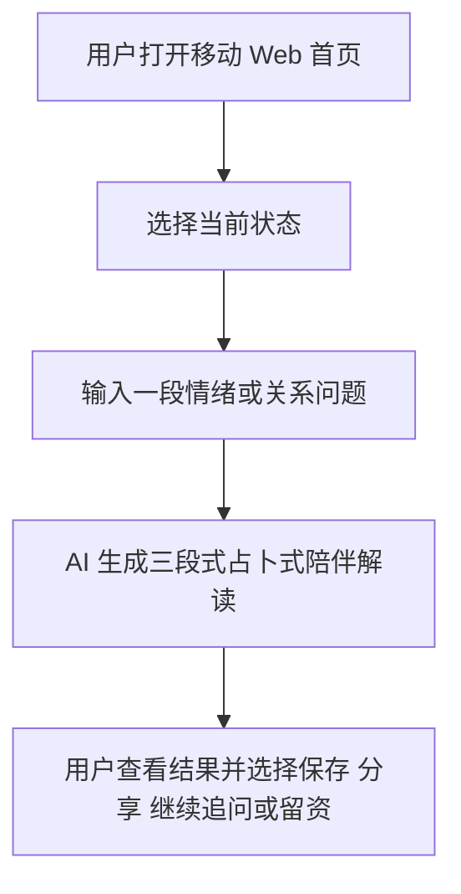

# 1. 项目概述

> 本文件是 PRD/ 文件夹的第 1 部分。如需了解产品全貌请先读 [README.md](./README.md)。
> 上一模块：无 · 下一模块：[02-tech-stack.md](./02-tech-stack.md)

---

## 1. 项目概述

### 产品名称

Moonlit Tarot Companion

### 一句话描述

Moonlit Tarot Companion 是一个面向泰语情绪承压用户的移动优先 Web 产品，让用户输入当前情绪或关系问题后，获得一段先共情、再占卜式解释、最后给出温和行动建议的 AI 陪伴解读。

### 核心价值主张

- **用户痛点**：用户在疲惫、孤独、分手、家庭责任压力中缺少一个能安全表达脆弱、又能用占卜/命理语言获得解释和方向感的低门槛出口。[C-7542084841076985096_301ee076, C-7522481449962851602_5652eb8f]
- **我们的解法**：把占卜作为情绪表达的外壳，先接住情绪，再用塔罗/命理叙事帮助用户理解处境，最后给出一个小到能立刻执行的下一步。
- **差异化**：不是娱乐抽牌，也不是普通 AI 安慰；核心顺序是“接住情绪 → 占卜式解释 → 温和行动”，并用泰语语境承接用户已经熟悉的祈愿和接受预测表达。[C-7522481449962851602_ce863b3b, C-7522481449962851602_9420959b]

### 目标用户

- **主要用户**：在 TikTok 泰语占卜/命理内容下留言、正处于分手关系、家庭责任、孤独或长期疲惫中的泰语用户。
- **使用场景**：深夜独处、情绪低谷、刷到占卜内容后被触发，想把“我很累”“我放不下”“没人理解我”讲得更完整，但不想暴露现实身份。
- **数据边界**：本 PRD 继承 BRD/MRD 的黄色证据等级；样本来自 TikTok 泰语评论，不能外推整体东南亚市场，也不能证明真实付费转化。[D-CTX]

### V1 核心功能

V1 只做 3 个核心功能，所有其他想法进入 V2 或更后面。

#### P0-1 情绪/关系状态选择 + 长文本输入

- **功能说明**：用户选择当前状态，并输入一段泰语情绪或关系问题。
- **验收标准**：
  - 用户可以在首页选择 `เหนื่อย`、`ความรัก`、`ครอบครัว`、`เหงา` 四类状态之一。
  - 用户可以提交不少于 20 个泰文字符的自由文本问题。
  - 输入为空、过短或明显不是泰语时，系统给出明确提示并停留在输入页。
  - 提交成功后进入生成中状态，不丢失用户输入。
- **不做清单**：
  - 不做账号注册和登录。
  - 不做复杂问卷、生日星盘、出生时间采集。
  - 不做上传图片、语音输入、视频输入。
  - 不做多轮聊天输入框；V1 只收一次完整问题。

#### P0-2 三段式占卜式陪伴解读

- **功能说明**：AI 根据用户状态和长文本，生成“共情接住、占卜式解释、温和行动建议”三段结果。
- **验收标准**：
  - 结果必须包含 `empathy`、`reading`、`nextStep` 三个结构化字段。
  - 结果使用泰语输出，语气温和、非评判、不制造依赖。
  - 结果不得给出绝对化预测、医疗诊断、法律/财务决策建议。
  - AI 超时或失败时，用户能看到重试入口和非 AI 兜底安慰文案。
- **不做清单**：
  - 不做真人占卜师后台。
  - 不承诺“准确预测未来”。
  - 不输出危机干预以外的医疗判断。
  - 不做复杂牌阵、牌库收藏、抽牌动画编辑器。

#### P0-3 结果页验证入口

- **功能说明**：结果页提供继续追问、保存/分享、留资/付费意愿测试入口，用于验证被接住感和私人化意愿。
- **验收标准**：
  - 用户能点击“继续看个人问题”并进入轻量转化弹层。
  - 用户能复制分享文本或保存当前结果到本地。
  - 用户能提交联系方式加入等待名单，或点击低价单次解读意愿按钮。
  - 系统记录 `result_viewed`、`followup_clicked`、`save_clicked`、`waitlist_submitted`、`paid_intent_clicked` 事件。
- **不做清单**：
  - 不接入真实支付。
  - 不做完整订单、优惠券、会员订阅。
  - 不做客服系统和人工派单。
  - 不做社区、评论区、公开结果广场。

### MVP 范围声明

- **V1 做**：
  - 移动优先 Web 落地页。
  - 状态选择和泰语长文本输入。
  - AI 三段式占卜式陪伴解读。
  - 结果页继续追问、保存/分享、等待名单和付费意愿测试。
  - 基础数据记录，用于验证提交、追问、保存和留资行为。
- **V1 不做**：
  - 不做完整 App。
  - 不做账号体系。
  - 不做真实支付。
  - 不做真人咨询供给端。
  - 不做社区和内容流。
  - 不做多语言切换，界面主语言为泰语，管理和开发文档为中文。

### 核心用户流程

### V1 成功标准

- **有效表达**：用户愿意提交完整情绪/关系问题，而不是只点开页面。
- **被接住感**：用户看完结果后愿意保存、分享或继续追问。
- **私人化意愿**：用户点击低价单次解读意愿或提交等待名单。

### 关键假设

- 用户愿意从 TikTok 评论区迁移到独立 Web 页面输入更完整、更私人的问题。
- 占卜式陪伴比普通 AI 安慰更符合泰语占卜评论用户的表达习惯。
- 关系困扰用户比泛情绪疲惫用户更接近低价单次付费或私人化追问。
- 泰语表达、文化语境和心理安全边界能被产品稳定处理。
