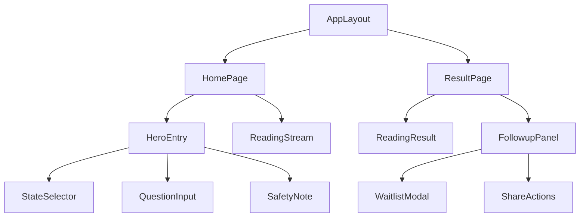

# 4. 页面与组件清单

> 本文件是 PRD/ 文件夹的第 4 部分。如需了解产品全貌请先读 [README.md](./README.md)。
> 上一模块：[03-design-handoff.md](./03-design-handoff.md) · 下一模块：[05-ai-capabilities.md](./05-ai-capabilities.md)

---

## 4. 页面与组件清单

### 页面路由

| 路由 | 页面名称 | 文件路径 | 功能描述 | 布局 |
|------|---------|---------|---------|------|
| `/` | 首页 | `src/app/page.tsx` | 状态选择、长文本输入、提交生成 | 单页移动优先布局 |
| `/result/[sessionId]` | 结果页 | `src/app/result/[sessionId]/page.tsx` | 展示三段式解读、追问和转化入口 | 结果阅读布局 |

### API 路由

| 路由 | 文件路径 | 方法 | 功能 |
|------|---------|------|------|
| `/api/reading` | `src/app/api/reading/route.ts` | `POST` | 创建匿名会话并生成 AI 解读 |
| `/api/events` | `src/app/api/events/route.ts` | `POST` | 记录行为事件 |
| `/api/waitlist` | `src/app/api/waitlist/route.ts` | `POST` | 提交等待名单联系方式 |

### 组件树



### 核心组件定义

#### HeroEntry

- **文件路径**：`src/components/landing/HeroEntry.tsx`
- **职责**：承载首页核心输入流程，组合状态选择、问题输入和提交按钮。
- **Props**：

```typescript
interface HeroEntryProps {
  initialStatus?: EmotionalStatus; // 可选默认状态
  onSubmit: (payload: IntakePayload) => Promise<void>; // 提交后触发 AI 解读
  isSubmitting: boolean; // 是否正在提交
}
```

- **内部状态**：当前选择状态、输入文本、表单校验错误。
- **依赖**：`StateSelector`、`QuestionInput`、`SafetyNote`、`useIntakeStore`。
- **交互行为**：
  - 用户选择状态 → 系统高亮该状态并写入 intake store。
  - 用户输入问题 → 系统实时更新字符计数和校验提示。
  - 用户点击提交 → 系统校验输入，校验通过后调用 `/api/reading`。

#### StateSelector

- **文件路径**：`src/components/intake/StateSelector.tsx`
- **职责**：让用户选择当前情绪或关系状态。
- **Props**：

```typescript
type EmotionalStatus = 'tired' | 'love' | 'family' | 'lonely';

interface StateSelectorProps {
  value: EmotionalStatus | null; // 当前选中的状态
  onChange: (status: EmotionalStatus) => void; // 状态变化回调
  disabled?: boolean; // 生成中禁止切换
}
```

- **内部状态**：无。
- **依赖**：基础按钮组件。
- **交互行为**：
  - 用户点击状态选项 → 系统选中该状态。
  - 用户再次点击已选状态 → 系统保持选中，不取消，避免误操作。

#### QuestionInput

- **文件路径**：`src/components/intake/QuestionInput.tsx`
- **职责**：收集用户的泰语长文本问题。
- **Props**：

```typescript
interface QuestionInputProps {
  value: string; // 用户输入文本
  onChange: (value: string) => void; // 输入变化回调
  minThaiChars: number; // 最少泰文字符数
  maxChars: number; // 最大字符数
  error?: string; // 校验错误
  disabled?: boolean; // 生成中禁止编辑
}
```

- **内部状态**：输入焦点状态、字符统计。
- **依赖**：`validateThaiInput`。
- **交互行为**：
  - 用户输入文本 → 系统显示当前长度和校验状态。
  - 用户输入超过限制 → 系统阻止继续提交并显示错误。
  - 用户离开输入框 → 系统执行泰语比例和长度校验。

#### ReadingStream

- **文件路径**：`src/components/reading/ReadingStream.tsx`
- **职责**：展示 AI 正在生成解读时的流式状态。
- **Props**：

```typescript
interface ReadingStreamProps {
  status: 'idle' | 'loading' | 'streaming' | 'error'; // 当前生成状态
  partialText?: string; // 流式文本片段
  errorMessage?: string; // 错误提示
  onRetry: () => void; // 重试生成
  onCancel: () => void; // 取消生成
}
```

- **内部状态**：流式文本展示进度。
- **依赖**：`useReadingStore`。
- **交互行为**：
  - 系统开始生成 → 用户看到陪伴式等待状态。
  - 用户点击取消 → 系统中断请求并保留输入。
  - 生成失败 → 系统展示重试入口和兜底文案。

#### ReadingResult

- **文件路径**：`src/components/reading/ReadingResult.tsx`
- **职责**：展示三段式占卜式陪伴解读。
- **Props**：

```typescript
interface ReadingResultProps {
  result: ReadingResultData; // 三段式解读结构
  createdAt: string; // 生成时间
  statusLabel: string; // 用户选择状态的泰语标签
}

interface ReadingResultData {
  empathy: string; // 共情接住
  reading: string; // 占卜式解释
  nextStep: string; // 温和行动建议
  safetyNote?: string; // 必要时的安全提示
}
```

- **内部状态**：无。
- **依赖**：`ShareActions`。
- **交互行为**：
  - 用户进入结果页 → 系统记录 `result_viewed`。
  - 用户阅读到末尾 → 系统展示 `FollowupPanel`。

#### FollowupPanel

- **文件路径**：`src/components/conversion/FollowupPanel.tsx`
- **职责**：承载继续追问、保存/分享、留资/付费意愿测试入口。
- **Props**：

```typescript
interface FollowupPanelProps {
  sessionId: string; // 当前匿名会话 ID
  resultText: string; // 可复制分享的结果文本
  enablePaidIntent: boolean; // 是否展示付费意愿按钮
  enableWaitlist: boolean; // 是否展示等待名单
  onEvent: (event: TrackingEventName) => Promise<void>; // 行为记录
}
```

- **内部状态**：等待名单弹层开关、复制成功状态、提交中状态。
- **依赖**：`WaitlistModal`、`ShareActions`、`trackEvent`。
- **交互行为**：
  - 用户点击继续追问 → 系统记录事件并打开等待名单或意愿入口。
  - 用户点击保存/分享 → 系统复制结果并记录事件。
  - 用户点击低价单次解读意愿 → 系统记录事件，不进入真实支付。

#### WaitlistModal

- **文件路径**：`src/components/conversion/WaitlistModal.tsx`
- **职责**：收集愿意进一步获得私人化解读的联系方式。
- **Props**：

```typescript
interface WaitlistModalProps {
  open: boolean; // 是否显示弹层
  sessionId: string; // 当前匿名会话 ID
  onClose: () => void; // 关闭弹层
  onSubmitted: () => void; // 提交成功回调
}
```

- **内部状态**：联系方式、提交状态、错误提示。
- **依赖**：`/api/waitlist`。
- **交互行为**：
  - 用户提交联系方式 → 系统校验格式并写入 waitlist。
  - 提交成功 → 系统显示成功状态并记录 `waitlist_submitted`。
  - 提交失败 → 系统保留输入并允许重试。

#### SafetyNote

- **文件路径**：`src/components/intake/SafetyNote.tsx`
- **职责**：说明产品边界，避免用户把占卜式陪伴理解为医疗或绝对预测。
- **Props**：

```typescript
interface SafetyNoteProps {
  variant: 'compact' | 'full'; // 首页简版或结果页完整版
}
```

- **内部状态**：无。
- **依赖**：无。
- **交互行为**：
  - 用户展开说明 → 系统展示非医疗、非绝对预测、危机求助提示。

### 页面验收

- 首页首屏必须能完成状态选择和问题输入，不把核心操作藏到二级页面。
- 结果页必须能独立打开，刷新后可从数据库恢复结果。
- 所有用户可见文案默认泰语。
- 桌面端可以响应式展示，但 V1 不单独设计桌面复杂布局。
