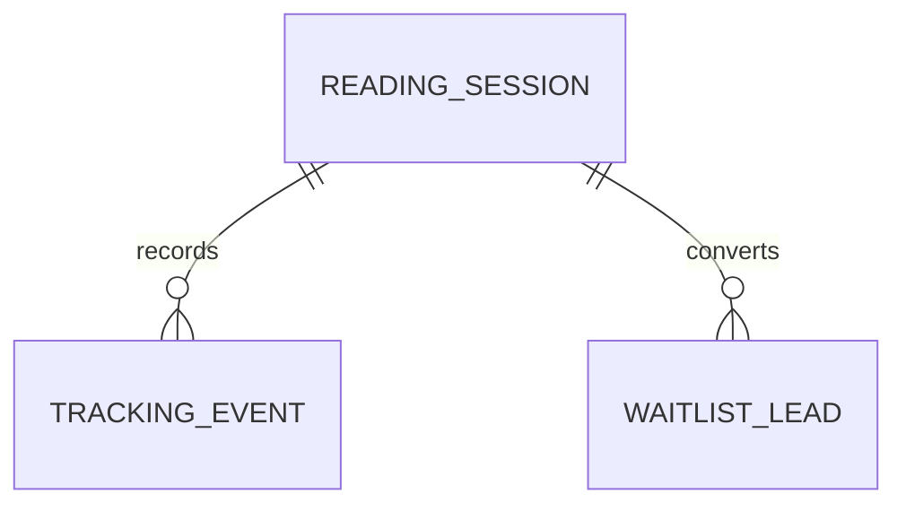

# 6. 数据模型

> 本文件是 PRD/ 文件夹的第 6 部分。如需了解产品全貌请先读 [README.md](./README.md)。
> 上一模块：[05-ai-capabilities.md](./05-ai-capabilities.md) · 下一模块：[07-business-logic.md](./07-business-logic.md)

---

## 6. 数据模型

### 数据实体

#### ReadingSession

```typescript
interface ReadingSession {
  id: string; // UUID，匿名会话主键
  status: 'tired' | 'love' | 'family' | 'lonely'; // 用户选择的状态
  question: string; // 用户输入的泰语问题
  language: 'th'; // V1 固定泰语
  result?: CompanionReadingOutput; // AI 生成结果
  generationStatus: 'pending' | 'success' | 'failed' | 'cancelled'; // 生成状态
  riskLevel: 'normal' | 'sensitive' | 'crisis'; // 安全风险等级
  errorCode?: string; // 失败原因
  createdAt: string; // 创建时间
  updatedAt: string; // 更新时间
}
```

#### TrackingEvent

```typescript
type TrackingEventName =
  | 'session_created'
  | 'reading_started'
  | 'reading_succeeded'
  | 'reading_failed'
  | 'result_viewed'
  | 'followup_clicked'
  | 'save_clicked'
  | 'share_clicked'
  | 'paid_intent_clicked'
  | 'waitlist_submitted';

interface TrackingEvent {
  id: string; // UUID，事件主键
  sessionId?: string; // 关联 ReadingSession，可为空
  name: TrackingEventName; // 事件名
  metadata: Record<string, string | number | boolean | null>; // 事件上下文
  createdAt: string; // 创建时间
}
```

#### WaitlistLead

```typescript
interface WaitlistLead {
  id: string; // UUID，线索主键
  sessionId: string; // 来源会话
  contactType: 'line' | 'email' | 'phone' | 'other'; // 联系方式类型
  contactValue: string; // 联系方式，服务端写入
  intent: 'followup' | 'paid_reading' | 'human_enhanced'; // 用户意向
  note?: string; // 用户补充说明
  createdAt: string; // 创建时间
}
```

#### LocalSavedReading

```typescript
interface LocalSavedReading {
  sessionId: string; // 会话 ID
  status: EmotionalStatus; // 用户选择状态
  result: CompanionReadingOutput; // 保存的解读
  savedAt: string; // 本地保存时间
}
```

### 实体关系



### Supabase 建表 SQL

```sql
create table reading_sessions (
  id uuid primary key default gen_random_uuid(),
  status text not null check (status in ('tired', 'love', 'family', 'lonely')),
  question text not null,
  language text not null default 'th',
  result jsonb,
  generation_status text not null default 'pending' check (generation_status in ('pending', 'success', 'failed', 'cancelled')),
  risk_level text not null default 'normal' check (risk_level in ('normal', 'sensitive', 'crisis')),
  error_code text,
  created_at timestamptz not null default now(),
  updated_at timestamptz not null default now()
);

create table tracking_events (
  id uuid primary key default gen_random_uuid(),
  session_id uuid references reading_sessions(id) on delete set null,
  name text not null,
  metadata jsonb not null default '{}'::jsonb,
  created_at timestamptz not null default now()
);

create table waitlist_leads (
  id uuid primary key default gen_random_uuid(),
  session_id uuid not null references reading_sessions(id) on delete cascade,
  contact_type text not null check (contact_type in ('line', 'email', 'phone', 'other')),
  contact_value text not null,
  intent text not null check (intent in ('followup', 'paid_reading', 'human_enhanced')),
  note text,
  created_at timestamptz not null default now()
);

create index tracking_events_session_id_idx on tracking_events(session_id);
create index waitlist_leads_session_id_idx on waitlist_leads(session_id);
```

### 本地存储

| Key | 数据类型 | 用途 | 过期策略 |
|-----|---------|------|---------|
| `moonlit.savedReadings` | `LocalSavedReading[]` | 保存用户主动保存的结果 | 最多保留最近 20 条 |
| `moonlit.lastIntakeDraft` | `{ status, question, updatedAt }` | 防止输入中断丢失 | 7 天后清理 |
| `moonlit.anonymousId` | `string` | 匿名事件关联 | 用户清除浏览器数据后失效 |

### 数据流向

1. 用户在首页提交状态和问题。
2. `/api/reading` 创建 `ReadingSession`，写入 `session_created` 和 `reading_started`。
3. AI 生成成功后更新 `ReadingSession.result` 和 `generationStatus`。
4. 结果页打开时读取 `ReadingSession` 并记录 `result_viewed`。
5. 用户保存/分享/追问/留资时写入 `TrackingEvent`。
6. 用户提交联系方式时写入 `WaitlistLead`。

### V1 数据边界

- 不存真实姓名、头像、社交账号画像。
- 联系方式只在用户主动提交等待名单时保存。
- V1 不做用户账号；所有会话都是匿名 ID。
- V1 不做支付数据；付费意愿只记录点击事件。
