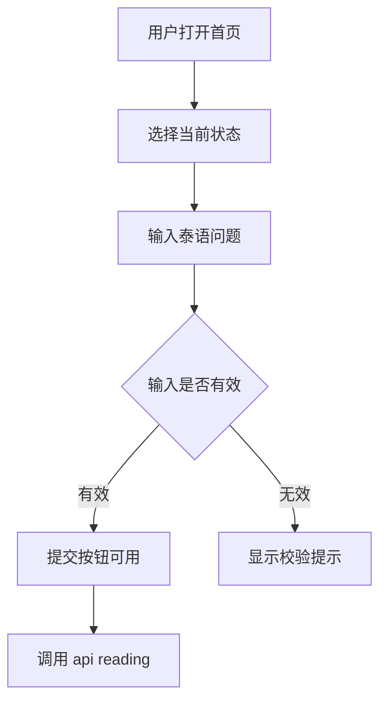
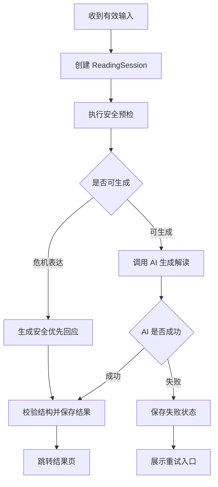
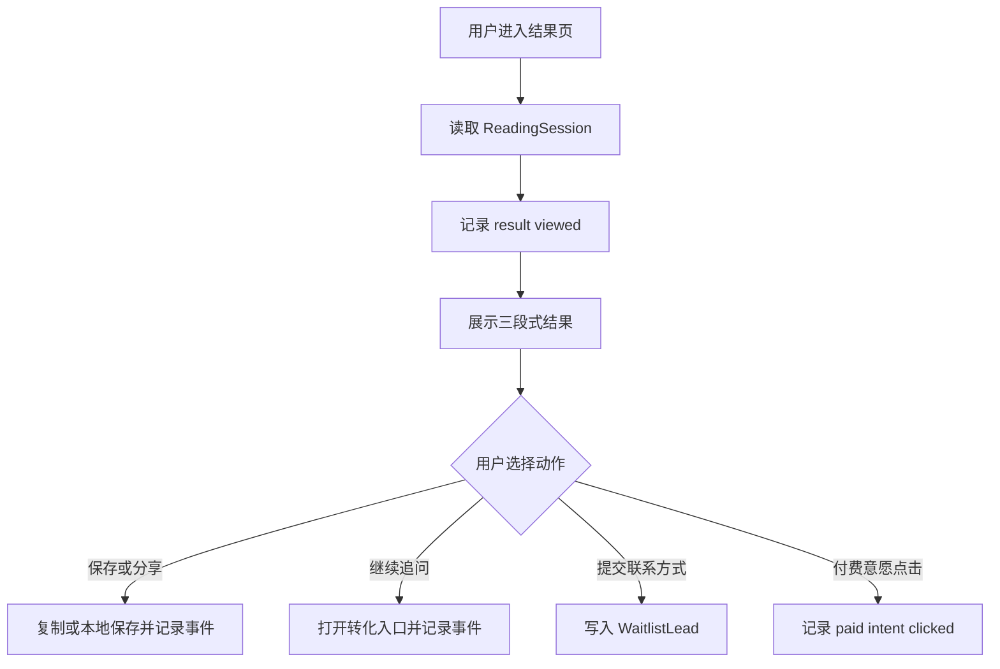

# 7. 核心业务逻辑

> 本文件是 PRD/ 文件夹的第 7 部分。如需了解产品全貌请先读 [README.md](./README.md)。
> 上一模块：[06-data-model.md](./06-data-model.md) · 下一模块：[08-state-management.md](./08-state-management.md)

---

## 7. 核心业务逻辑

### 功能一：状态选择与长文本输入

#### 触发条件

用户打开首页并开始选择状态、输入泰语问题。

#### 处理流程

#### 业务规则

- 状态必须四选一：疲惫、关系、家庭、孤独。
- 问题必须包含足够泰语内容，避免英文测试文本或空输入污染结果。
- 问题必须低于最大长度限制，超出时不提交。
- 用户输入保存在本地草稿，刷新页面后可恢复。

#### 输入输出

- **输入**：`status`、`question`。
- **输出**：合法的 `IntakePayload`。
- **副作用**：更新 `intake-store`，写入本地草稿。

#### 边界情况

| 场景 | 系统行为 | 用户感知 |
|------|---------|---------|
| 未选择状态 | 阻止提交 | 看到选择状态提示 |
| 输入过短 | 阻止提交 | 看到“请多写一点”的泰语提示 |
| 非泰语内容 | 阻止提交 | 看到语言不匹配提示 |
| 刷新页面 | 恢复草稿 | 输入不丢失 |

### 功能二：三段式占卜式陪伴解读

#### 触发条件

用户提交有效状态和问题。

#### 处理流程

#### 业务规则

- AI 输出必须包含共情、占卜式解释、下一步行动三段。
- 泰语是唯一用户输出语言。
- 对关系问题可以给“看见自己需求”的解释，不能诱导纠缠、监控、报复。
- 对危机表达优先显示安全提示，降低占卜叙事比例。
- AI 调用和 Prompt 细节参见 [05-ai-capabilities.md](./05-ai-capabilities.md) 的 `generateCompanionReading`。

#### 输入输出

- **输入**：`IntakePayload`。
- **输出**：`CompanionReadingOutput`。
- **副作用**：创建/更新 `ReadingSession`，写入生成相关事件。

#### 边界情况

| 场景 | 系统行为 | 用户感知 |
|------|---------|---------|
| AI 超时 | 中断请求并保留输入 | 可重试，不需要重写问题 |
| AI 返回格式错误 | 丢弃结果并重试一次 | 若仍失败，显示兜底文案 |
| 危机表达 | 输出安全提示并建议联系可信任的人或当地紧急资源 | 感到被认真对待，而不是被占卜敷衍 |
| 数据库写入失败 | 前端仍展示当前结果，本地记录临时 session | 用户能看到结果，但提示保存可能失败 |

### 功能三：结果页验证入口

#### 触发条件

用户进入结果页并查看 AI 解读。

#### 处理流程

#### 业务规则

- 保存/分享动作不能强制用户留资。
- 继续追问入口用于验证意愿，不在 V1 打开真实多轮对话。
- 低价单次解读按钮只记录意愿，不接入真实支付。
- 等待名单提交必须关联当前 `sessionId`。

#### 输入输出

- **输入**：`sessionId`、用户点击行为、可选联系方式。
- **输出**：事件记录、等待名单记录、本地保存结果。
- **副作用**：写入 `TrackingEvent`、`WaitlistLead`、localStorage。

#### 边界情况

| 场景 | 系统行为 | 用户感知 |
|------|---------|---------|
| session 不存在 | 展示结果不存在状态 | 可返回首页重新生成 |
| 复制失败 | 提供手动复制文本区域 | 用户仍可拿到内容 |
| 等待名单提交失败 | 保留表单并允许重试 | 联系方式不丢失 |
| 事件记录失败 | 不阻塞用户动作 | 用户不会被埋点错误打断 |
