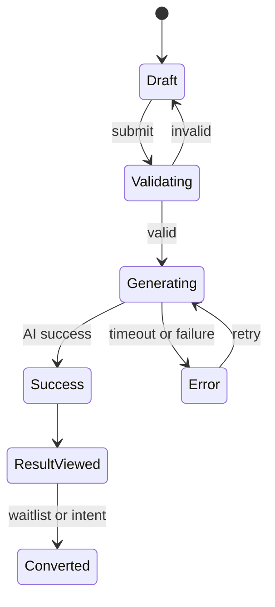

# 8. 状态管理

> 本文件是 PRD/ 文件夹的第 8 部分。如需了解产品全貌请先读 [README.md](./README.md)。
> 上一模块：[07-business-logic.md](./07-business-logic.md) · 下一模块：[09-error-handling.md](./09-error-handling.md)

---

## 8. 状态管理

### 全局状态结构

```typescript
interface IntakeState {
  status: EmotionalStatus | null; // 用户选择状态，持久化为草稿
  question: string; // 用户输入问题，持久化为草稿
  validationError: string | null; // 当前校验错误，临时
  isSubmitting: boolean; // 是否提交中，临时
}

interface IntakeActions {
  setStatus: (status: EmotionalStatus) => void;
  setQuestion: (question: string) => void;
  validate: () => boolean;
  reset: () => void;
  restoreDraft: () => void;
}

interface ReadingState {
  sessionId: string | null; // 当前会话 ID，临时
  status: 'idle' | 'loading' | 'streaming' | 'success' | 'error'; // 生成状态
  result: CompanionReadingOutput | null; // 当前结果，临时
  errorMessage: string | null; // 当前错误，临时
}

interface ReadingActions {
  start: (payload: IntakePayload) => Promise<void>;
  retry: () => Promise<void>;
  cancel: () => void;
  loadBySessionId: (sessionId: string) => Promise<void>;
  clearError: () => void;
}

interface ConfigState {
  enablePaidIntent: boolean; // 来自环境变量
  enableWaitlist: boolean; // 来自环境变量
  primaryLanguage: 'th'; // V1 固定
}
```

### Store 划分

| Store 名称 | 职责 | 包含状态 |
|-----------|------|---------|
| `useIntakeStore` | 首页输入流程 | `status`、`question`、`validationError`、`isSubmitting` |
| `useReadingStore` | AI 生成和结果读取 | `sessionId`、`status`、`result`、`errorMessage` |
| `useConfigStore` | 运行配置 | `enablePaidIntent`、`enableWaitlist`、`primaryLanguage` |

### 状态流转



### 持久化策略

- `useIntakeStore.status` 和 `useIntakeStore.question` 持久化到 `moonlit.lastIntakeDraft`，用于刷新恢复。
- `ReadingSession` 以 Supabase 为准；前端 store 只保存当前页面需要的结果。
- 用户主动保存的结果写入 `moonlit.savedReadings`。
- `ConfigState` 不持久化，由环境变量或服务端配置注入。

### 状态边界

- 表单错误只放在 `useIntakeStore`，不要混进 AI 生成状态。
- AI 生成错误只放在 `useReadingStore`，不要污染输入草稿。
- 行为事件不进入全局 store，使用 `trackEvent` fire-and-forget。
- Waitlist 表单状态只在 `WaitlistModal` 内部维护。
